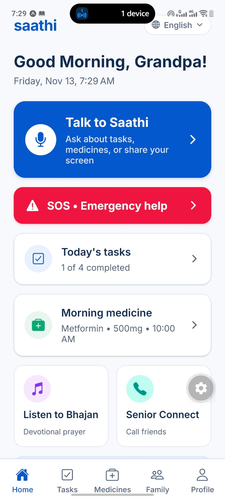
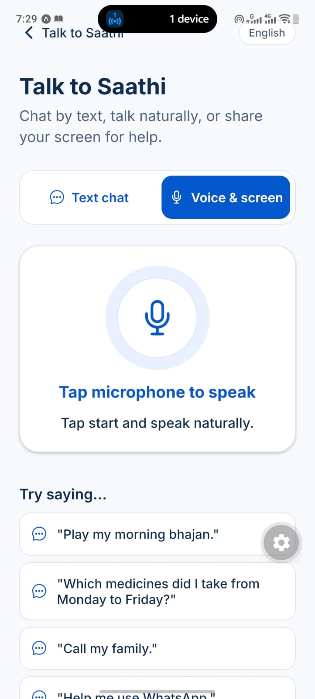
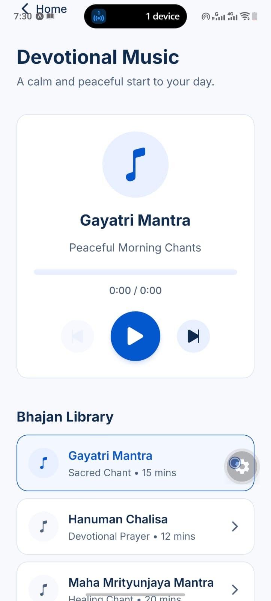
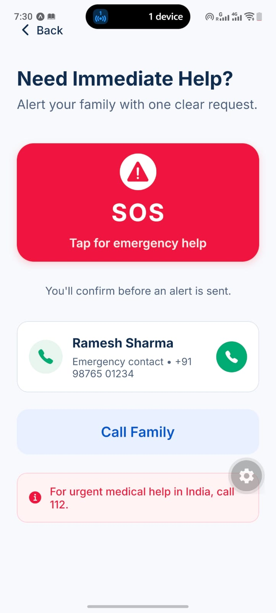
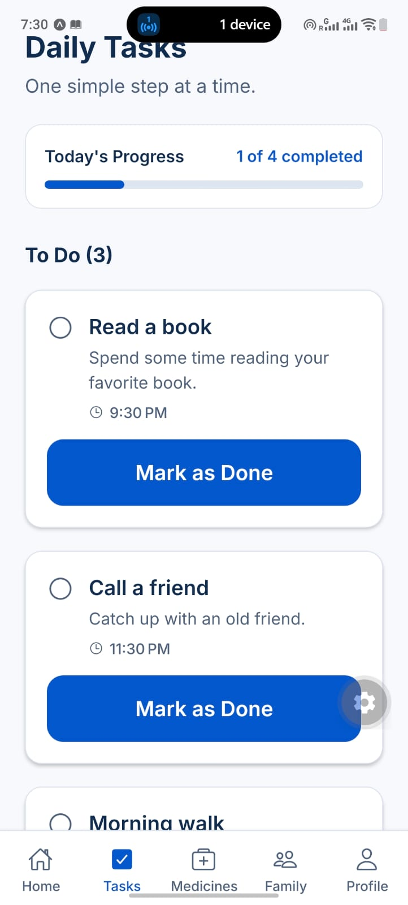
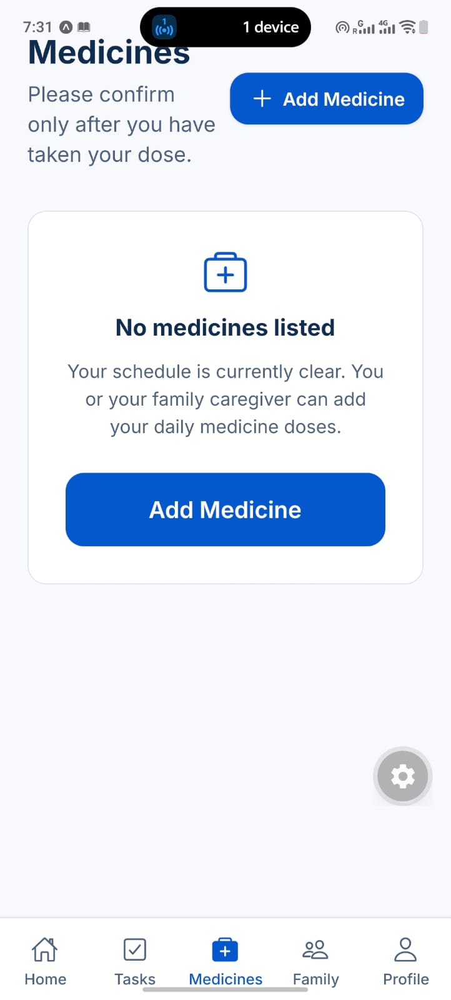
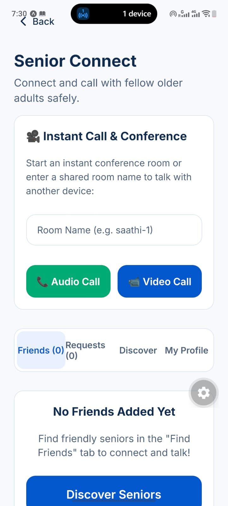
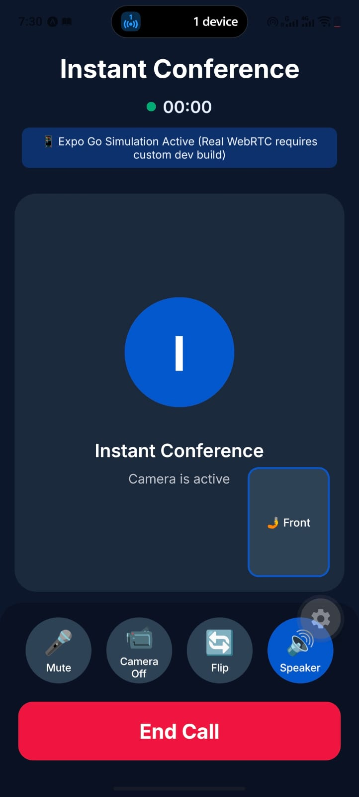
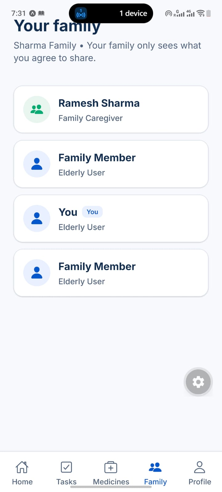
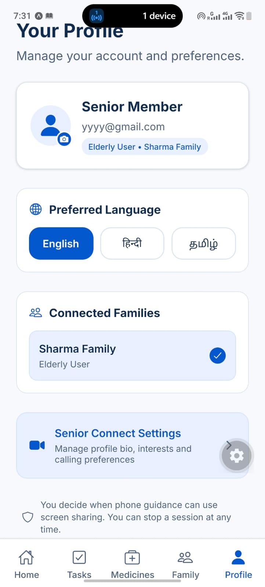

# Saathi (साथी) — Project Overview & Setup Guide

> **Saathi** is an AI-powered companion and remote family care platform built for older adults and their caregivers. It bridges the digital and physical divide with senior-first ergonomics, real-time family coordination, and multimodal AI assistance.

---

## 1. The Problem We Are Solving

* **Digital Exclusion & Cognitive Overload**: Mainstream apps use tiny buttons, complex nested menus, low-contrast text, and rapid animations that confuse and alienate elderly users.
* **Severe Isolation & Loneliness**: Seniors spending long hours alone lack a warm, patient conversational partner who understands their language and cultural context.
* **Ineffective Emergency Response**: When an accident happens, standard SOS buttons only send a cryptic SMS. Caregivers receive zero situational context (no visuals, no camera angles, no live screen state), leading to panic and delayed medical help.
* **Medication & Routine Non-Adherence**: Managing multiple prescriptions and daily routines is stressful. Missed doses often go unnoticed until health complications arise.
* **Disconnected Caregiving**: Family members living in different cities struggle to coordinate tasks, check in on daily health, or assist elderly parents with confusing phone tasks.

---

## 2. Visual Tour & App Screenshots

### 👵 Senior Experience & Conversational AI

| **1. Senior Home Dashboard** | **2. Saathi AI Voice Companion** | **3. Devotional Music (Bhajan)** |
| :---: | :---: | :---: |
|  |  |  |
| *64px touch targets, daily summary, medicine glances, and quick actions.* | *Gemini-powered voice, text, and screen companion with contextual prompts.* | *Peaceful morning prayer library featuring Gayatri Mantra & Hanuman Chalisa.* |

---

### 🚨 Emergency SOS & Daily Routines

| **4. Emergency SOS Hub** | **5. Daily Tasks Checklist** | **6. Medicines Tracker** |
| :---: | :---: | :---: |
|  |  |  |
| *Prominent emergency trigger with immediate caregiver dial & 112 medical access.* | *Distraction-free daily tasks checklist with 1-tap "Mark as Done".* | *Dosage scheduling, adherence confirmation, and shared caregiver visibility.* |

---

### 👨‍👩‍👦 Social Connection, Video Guidance & Family Hub

| **7. Senior Connect Calling** | **8. Live Video Conference** | **9. Family Hub & Profiles** |
| :---: | :---: | :---: |
|  |  |  |
| *Safe social connection rooms to discover fellow older adults and combat isolation.* | *WebRTC video conference with live camera preview, audio controls, and camera flip.* | *Transparent family connection tree linking caregivers and senior members.* |

---

### ⚙️ Accessibility & Language Settings

| **10. User Profile & Multilingual Preferences** |
| :---: |
|  |
| *English, Hindi (हिंदी), and Tamil (தமிழ்) toggle with screen-share privacy controls.* |

---

## 3. How We Solve It

### A. Senior-First Ergonomics
* **Zero Cognitive Clutter**: High-contrast typography, large touch cards (minimum 64px hit areas), and zero confusing swipe gestures.
* **Multilingual Accessibility**: Native support for **English**, **Hindi (हिंदी)**, and **Tamil (தமிழ்)** across all text and voice interactions.

### B. Intelligent AI Companion (Gemini Live & Gemini Flash)
* **Warm Conversational AI**: Acts as a patient daily companion capable of answering questions, chatting warmly, and discussing interests.
* **Tool-Augmented Assistance**: Can read and schedule daily tasks, look up medication times, confirm taken doses, and record personal interests directly via function calling.
* **Screen Sharing & Guidance**: Seniors can share their phone screen with Saathi for gentle, step-by-step assistance with apps and settings.

### C. Multi-Angle Silent SOS Capture
* **Instant Dispatch**: Emergency alert is delivered immediately to caregivers without waiting for media uploads.
* **Silent Evidence Gathering**: Silently captures a **front camera photo**, **back camera photo**, and **senior screen snapshot** in the background.
* **Secure Storage**: Uploads evidence to Supabase Storage and attaches live URLs to the emergency event.
* **Caregiver Alert Console**: Caregivers receive instant push notifications, view the multi-angle camera evidence, and can acknowledge or resolve the alert with one tap.

### D. Synchronized Family Hub
* **Realtime Architecture**: PostgreSQL Row-Level Security (RLS) with Supabase Realtime keeps tasks, medicines, and alerts synchronized instantly across all family devices.
* **Spiritual & Mindful Wellness**: Integrated Bhajan and soothing spiritual audio player built right into the home screen.

---

## 4. System Workflow

```
[ Senior Device ]                      [ Backend (FastAPI) ]                  [ Caregiver Device ]
       │                                         │                                      │
       ├──── 1. Trigger SOS ────────────────────>│                                      │
       │     (Instant event creation)            ├──── 2. Realtime WebSocket Alert ────>│
       │                                         ├──── 3. Firebase Push Notification ──>│
       │                                         │                                      │ (Alert banner appears)
       ├──── 4. Silent Background Capture ──────>│                                      │
       │     - Front camera photo                ├──── 5. Upload to Supabase Storage    │
       │     - Back camera photo                 │        (emergency-media bucket)      │
       │     - Senior screen snapshot            │                                      │
       │                                         ├──── 6. Attach Evidence URLs ────────>│
       │                                         │                                      │ (Views photos & screen)
       │                                         │<─── 7. Acknowledge Alert ────────────┤
       │<─── 8. "Caregiver Acknowledged" ────────┤                                      │
       │     (Status updates in real-time)       │<─── 9. Mark Resolved ────────────────┤
       │                                         │                                      │
```

---

## 5. Getting Started (Run Locally)

### Prerequisites
* **Node.js**: v20 or higher (`node -v`)
* **Python**: v3.11 or higher (`python3 --version`)
* **Package Managers**: `npm` and `pip`
* **Git**: Installed and configured

---

### Step 1: Clone the Repository
```bash
git clone https://github.com/amansingh2009/Saathi.git
cd Saathi
```

---

### Step 2: Configure & Start the Backend

1. Navigate to the backend directory:
   ```bash
   cd backend
   ```

2. Create and activate a Python virtual environment:
   ```bash
   python3 -m venv .venv
   source .venv/bin/activate
   ```

3. Install required Python packages:
   ```bash
   pip install -r requirements.txt
   ```

4. Verify or create your `.env` file (`backend/.env`):
   ```env
   APP_ENV=development
   API_V1_PREFIX=/api/v1
   SUPABASE_URL=https://mrcuxavgdzxbaheshpzs.supabase.co
   SUPABASE_PUBLISHABLE_KEY=sb_publishable_eU7mKB5BDJgQFynK_CNg-g_71v7xLY4
   SUPABASE_JWT_ISSUER=https://mrcuxavgdzxbaheshpzs.supabase.co/auth/v1
   SUPABASE_JWT_AUDIENCE=authenticated
   SUPABASE_SERVICE_ROLE_KEY=<YOUR_SUPABASE_SERVICE_ROLE_KEY>
   GEMINI_API_KEY=<YOUR_GEMINI_API_KEY>
   GEMINI_TEXT_MODEL=gemini-3-flash-preview
   GEMINI_LIVE_MODEL=gemini-3.8-live
   GEMINI_SCREEN_MODEL=gemini-3-flash-preview
   LIVEKIT_URL=wss://saathi-jcyj1o0z.livekit.cloud
   LIVEKIT_API_KEY=<YOUR_LIVEKIT_KEY>
   LIVEKIT_API_SECRET=<YOUR_LIVEKIT_SECRET>
   ```

5. Launch the FastAPI server:
   ```bash
   uvicorn app.main:app --reload --host 0.0.0.0 --port 8765
   ```
   * *Swagger API documentation*: `http://localhost:8765/docs`

---

### Step 3: Configure & Start the Mobile App

1. In a new terminal window, navigate to the mobile directory:
   ```bash
   cd mobile
   ```

2. Install dependencies:
   ```bash
   npm install
   ```

3. Verify `mobile/.env`:
   ```env
   EXPO_PUBLIC_API_BASE_URL=http://localhost:8765/api/v1
   EXPO_PUBLIC_SUPABASE_URL=https://mrcuxavgdzxbaheshpzs.supabase.co
   EXPO_PUBLIC_SUPABASE_PUBLISHABLE_KEY=sb_publishable_eU7mKB5BDJgQFynK_CNg-g_71v7xLY4
   ```

4. Start the application:
   * **For Web Browser**:
     ```bash
     npm run web
     ```
     Open `http://localhost:8081` in Chrome or your browser.
   * **For Android Device / Emulator**:
     ```bash
     npx expo run:android
     ```

---

### Step 4: Run Automated Tests

* **Backend test suite (52 tests)**:
  ```bash
  cd backend && .venv/bin/pytest
  ```

* **Mobile type check & unit tests (18 tests)**:
  ```bash
  cd mobile
  npx tsc --noEmit
  npm test
  ```

---

## 6. Key Technology Stack

| Layer | Technologies |
| :--- | :--- |
| **Mobile Client** | React Native, Expo SDK 58, Expo Router, TypeScript, React Query, Zustand |
| **Backend API** | FastAPI, Uvicorn, Python 3.14, Pydantic v2, HTTPX |
| **AI & Multimodal** | Google Gemini 3.8 Live, Gemini 3 Flash, Gemini Function Calling |
| **Realtime & Database**| Supabase (PostgreSQL 15), Row Level Security (RLS), Supabase Storage |
| **Video & Audio** | LiveKit Cloud, WebRTC, Expo Audio |
| **Push Notifications** | Firebase Cloud Messaging (FCM) |

