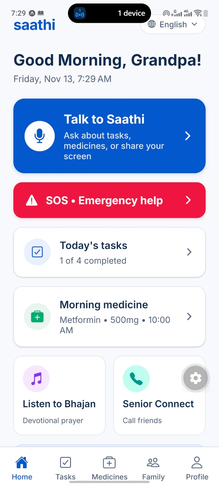
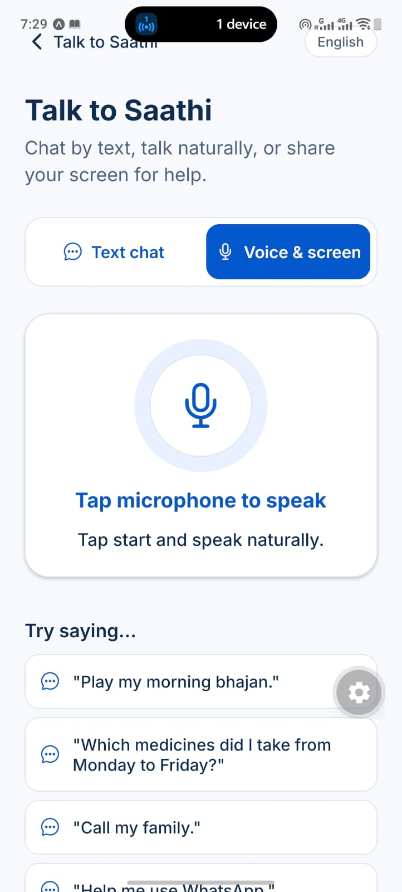
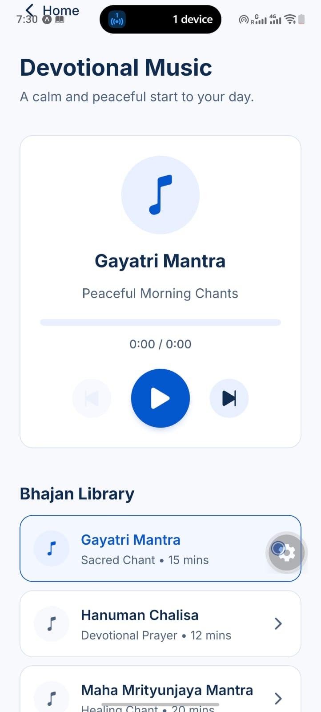
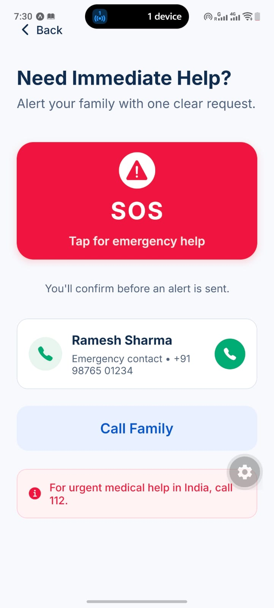
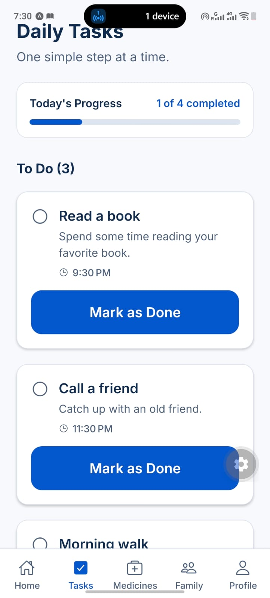
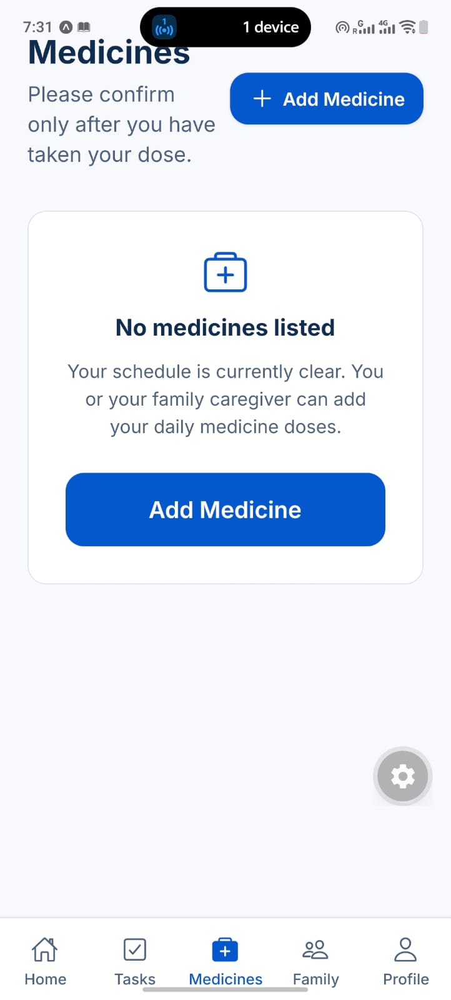
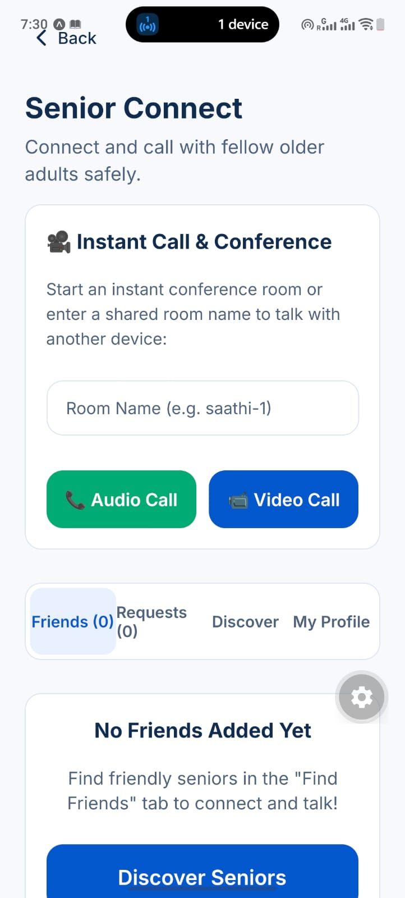
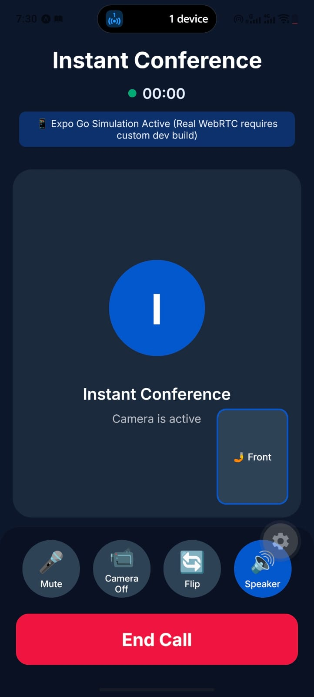
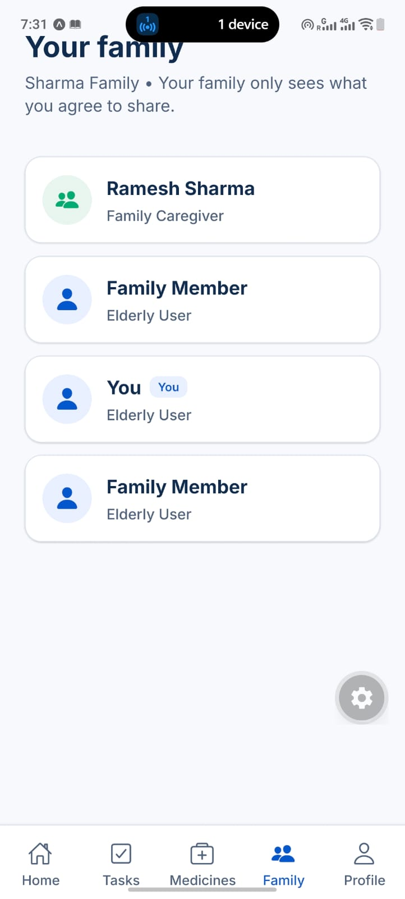
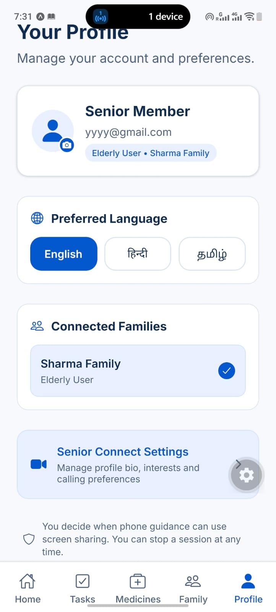

# Saathi (साथी) — AI Companion & Remote Care for Older Adults

<p align="center">
  <b>Bridging the digital divide for seniors with voice-first AI companionship, silent multi-angle SOS emergencies, and real-time family care coordination.</b>
</p>

<p align="center">
  
  
  
  
  
  
</p>

> 📖 **Deep Dive Document**: See [PROJECT_OVERVIEW.md](file:///Users/amansingh/dev/hackathonproj/PROJECT_OVERVIEW.md) for in-depth problem statements, sequence diagrams, and local reproduction steps.

---

## 📱 App Screenshots & Visual Walkthrough

### 1. Daily Life & Conversational AI

| **Home Dashboard** | **Saathi Voice & Screen AI** | **Devotional Chants (Bhajan)** |
| :---: | :---: | :---: |
|  |  |  |
| *64px touch targets, daily summary, medicine glances, and 1-tap quick actions.* | *Gemini-powered conversational partner with voice input, text chat, and screen assistance.* | *Peaceful morning prayer library featuring Gayatri Mantra & Hanuman Chalisa.* |

---

### 2. Safety, Routine & Medications

| **Emergency SOS Hub** | **Daily Task Manager** | **Medicine Tracker & Reminders** |
| :---: | :---: | :---: |
|  |  |  |
| *High-visibility emergency trigger with direct caregiver dial and emergency services (112).* | *Distraction-free step-by-step to-do checklist with 1-tap "Mark as Done".* | *Dosage scheduling, adherence confirmation, and shared caregiver visibility.* |

---

### 3. Community, Video Guidance & Family Hub

| **Senior Connect Calling** | **Instant Video Conference** | **Family Hub & Caregivers** |
| :---: | :---: | :---: |
|  |  |  |
| *Safe social connection rooms to discover fellow older adults and combat isolation.* | *WebRTC video conference with live camera preview, audio controls, and camera flip.* | *Transparent family connection tree linking caregivers and senior members.* |

---

### 4. Account & Accessibility Preferences

| **User Profile & Multilingual Settings** |
| :---: |
|  |
| *English, Hindi (हिंदी), and Tamil (தமிழ்) toggle with screen-share privacy controls.* |

---

## 🎯 What Saathi Solves

* **Zero-Cognitive-Overload Ergonomics**: Extra-large 64px tap targets, high contrast themes, and simple single-action screens designed specifically for older hands and eyes.
* **Warm Multimodal AI Companion**: Built on Google Gemini (`gemini-3-flash-preview` & `gemini-3.8-live`) to answer questions, handle medicine/task queries through function calling, and guide through shared screens.
* **Silent Multi-Angle SOS**: Immediately dispatches emergency alerts while silently streaming front camera, rear camera, and screen captures to caregivers for zero-confusion situational awareness.
* **Synchronized Family Coordination**: Real-time Supabase PostgreSQL replication with Row Level Security keeps caregivers updated the moment a task or medicine is confirmed.

---

## 🏗️ Architecture & Technology Stack

```
   [ Senior / Caregiver Devices (Expo React Native) ]
                          │
       ┌──────────────────┼──────────────────┐
       ▼                  ▼                  ▼
[ FastAPI Backend ]  [ Supabase Realtime ]  [ LiveKit Cloud ]
  • Gemini Function    • PostgreSQL RLS        • WebRTC Audio
    Calling            • Storage Buckets       • Realtime Video
  • Auth Verification  • Live Event Sync       • Low Latency
  • Silent Media Hub
```

| Layer | Technologies |
| :--- | :--- |
| **Mobile Client** | React Native, Expo SDK 58, Expo Router, TypeScript, Zustand, React Query |
| **Backend API** | FastAPI, Python 3.14 / 3.11, Pydantic v2, Uvicorn, HTTPX |
| **AI & Multimodal** | Google Gemini 3 Flash Preview (`gemini-3-flash-preview`), Gemini Live (`gemini-3.8-live`) |
| **Database & Realtime** | Supabase (PostgreSQL 15), Row-Level Security (RLS), Supabase Storage |
| **Video & Communication**| LiveKit Cloud WebRTC, Expo Audio |
| **Push Notifications** | Firebase Cloud Messaging (FCM) |

---

## 🚀 Running Locally

### 1. Start the Backend API

```bash
cd backend
python3 -m venv .venv
source .venv/bin/activate
pip install -r requirements.txt
uvicorn app.main:app --reload --host 0.0.0.0 --port 8765
```
*API docs will be available at `http://localhost:8765/docs`.*

### 2. Start the Mobile Client

```bash
cd mobile
npm install

# Run in Web Browser
npm run web

# Or run on Android Emulator / Physical Device
npx expo run:android
```

### 3. Run Automated Tests

```bash
# Run backend test suite (52 tests)
cd backend && .venv/bin/pytest

# Run frontend typecheck & test suite (18 tests)
cd mobile && npx tsc --noEmit && npm test
```

---

## 📂 Repository Structure

- `mobile/` — Expo Router app, design tokens, Gemini Live audio resampler, SOS multi-angle capture, and family views.
- `backend/` — FastAPI routes for AI companion, tasks, medicines, emergency events, media uploads, and family permissions.
- `supabase/migrations/` — PostgreSQL tables, Row-Level Security policies, and atomic database functions.
- `docs/screenshots/` — Actual application screenshots showcasing the full UI and workflows.
- `PROJECT_OVERVIEW.md` — Detailed problem statements, workflows, and implementation details.
